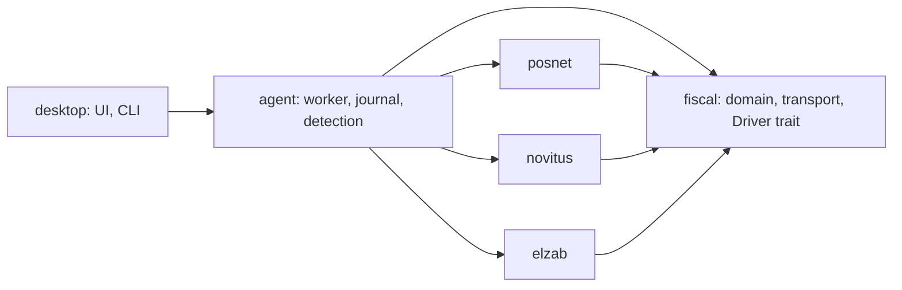

# Multi-vendor fiscal printers: Novitus and Elzab

Status: draft for approval · 2026-10-24

## Intent

Holuto Workshop prints Holuto sales, advances and fiscal reports on a Posnet
Temo Online only. Holuto's legacy printer model already knew three brands
(`posnet`, `novitus`, `elzab`: `../backend/src/archive.rs:1417-1420`), and
workshops own Novitus and Elzab printers. Add both brands with the same fiscal
safety guarantees as Posnet. Best end state, not smallest diff: Posnet-specific
code that blocks a clean multi-vendor design is rewritten.

## Goals

- Native drivers, over USB (CDC virtual COM) or RS232:
  - **Novitus**: native NOVITUS `ESC P` protocol (spec v1.15, 2026-02-27) for
    HD II Online, Deon Online, Bono Online and Point.
  - **Elzab**: native ElzabSTX protocol (vendor-recommended; serviced on USB
    regardless of the menu protocol) for Zeta Online, Mera Online and Cube
    Online.
- The brand is detected automatically on the port; nothing to choose.
- The port list shows only ports that can belong to one of the three brands.
- Holuto learns the brand and what the connected device can print, and refuses
  to queue jobs the device cannot print faithfully.
- Every fiscal invariant in README "Fiscal safety" and `.omp/RULES.md` holds
  for each brand.

## Non-goals

- Novitus XML protocol and NoviAPI (HTTPS REST over LAN). Both were evaluated;
  the native serial protocol keeps one connection model and covers all reports.
- Network transports. Elzab T10 Online is RNDIS/TCP only and is dropped.
- Elzab D10 and Zeta (non-online, legacy catalog), Posnet Ergo (a cash
  register, not a printer), Posnet models other than Temo Online.
- Frontend changes: `../frontend` still targets the legacy Django API.

## Anti-goals (failure even if it "works")

- Any substitution: printing advances as discounts (`$L`, `$Y`, storno),
  closing a fully prepaid sale with a nominal 0.01, transliterating or
  truncating names, mapping an unknown VAT sentinel to a rate.
- Retransmitting any frame, including on a transport-level NAK-like status
  (ElzabSTX `SL`, silence) or a Novitus checksum error after send.
- Using cancel/resume commands (Novitus `$e` action 0, `28;2$z`; Elzab
  `LCL RB`, `LCP`, `OPC`, `RRP` kind 14, `dPC` without `d`) in recovery.
- Changing printer configuration (code page, protocol, header, VAT table)
  during detection or preflight.

## Decided by the user

| Topic | Decision |
| --- | --- |
| Brands | Novitus and Elzab: the legacy backend enum's remaining two |
| Novitus protocol | Native NOVITUS over USB/serial |
| Elzab protocol | ElzabSTX (my call; vendor names it native and recommended) |
| Brand selection | Auto-detect on the port |
| Backend | Add `vendor` (and device capabilities) to telemetry |
| Unprintable jobs | Capabilities in telemetry; backend refuses to queue |
| Models | All current online models, minus T10 (network-only) |
| Port list | Printer USB IDs + RS232 paths; drop everything else |
| Validation | Real devices exist; a person runs a supervised checklist |
| Printer sharing | Each printer is dedicated to Workshop (documented) |
| Acceptance units | Demo units (destructive) + one fiscalized unit per brand |

Builder-check calls made by me (reviewable):

- Physical identity is `(vendor, serial)`. The backend pins `vendor` the way it
  pins `serial`: the first session sets it, and a different vendor later is
  refused with the existing serial-mismatch 409 path. Global serial uniqueness
  stays serial-only; a cross-brand collision fails closed as a pairing
  conflict.
- Telemetry also reports `maxQuantityDecimals`. Elzab accepts 5 and the
  backend schema allows 6, so the backend refuses queueing beyond the device
  limit, like the other limits. Company-name-in-header stays a local
  pre-dispatch check, because the backend cannot see the header.
- Discovery keeps today's scope: it probes the listed candidates only when the
  configured port fails and nothing blocks. Today that already sends Posnet
  `getrealid` to every candidate, including unrelated adapters.

## Research summary

Sources are the vendors' published protocol documents and driver packages
(not redistributed). Full cited research notes, with download URLs and
extraction steps, sit next to this document in
[`2026-10-24-multi-vendor-fiscal-printers/`](2026-10-24-multi-vendor-fiscal-printers/):
`novitus-protocol.md`, `elzab-protocol.md`, `usb-backend.md`, plus
`posnet-coupling.md` (how Posnet is wired into the app today). Key facts, as
Posnet today / Novitus native / ElzabSTX:

- **Framing and check**: `STX … #CRC16-XMODEM ETX` / `ESC P … cc ESC \`
  with XOR control byte / `STX hdr FS data CRC16-ARC ETX`.
- **Identity**: `getrealid` / `30#v` (original model) and unique number /
  `XTR`, `FNR`.
- **VAT read**: `vatget` A–G / `23#s` A–G, but the **exempt and inactive
  sentinels contradict each other** (v1.15 L1203 vs L20028-20036) / `FTR`
  A–G with `=` exempt and `?` inactive.
- **Clock**: `rtcget` / `#c` (YY epoch unverified) / `XCR` `YYMMDDhhmmss`.
- **Buyer NIP**: `trnipset` / `100;1$z` / `LNP` (timing vs first item
  unverified).
- **Advance per VAT**: `tradvance` / **only item-bound `@z`** (first matching
  item) / `LDS … RS 'D'` per slot.
- **Zero-total close**: yes / unverified / **error 1008 documented**.
- **Company footer**: `trftrln` id 25 / **no free-text footer** (`id25` is
  numeric; info lines once per day) / `LAL` (placement vs close unverified).
- **Payment codes** (cash, card, transfer, mobile, credit): 0, 2, 8, 6, 5 /
  0, 1, 8, 9, 5 / `X` 1, 2, 7, 9, 6.
- **Receipt number**: `scnt.bt` / `0;0?l`, DLE2 / `SER`.
- **Operator wait**: async `!sprn`/`!sdev` / real-time DLE, DLE2, ENQ during
  execution / no async channel documented.
- **Reports**: daily, monthly, periodic / `#r` (date-guarded), `#o` kinds
  0, 1, 6 / `RRP` (acknowledges **acceptance**), `RPP … S0` synchronous.
- **Certain refusal**: `trinit` error, report `ERR` frame / `$h` refusal,
  daily error 37 / transport-status rejection of the first frame.
- **USB ID**: VID `1424` / `1A28:2512`, ports A and B / generic CDC, STM
  `0483:5740` on some units.

## Architecture

### `crates/fiscal` (new, vendor-neutral)

Moves the domain out of `posnet` unchanged in meaning and serialized shape:
`money`, `decimal`, `receipt` (`Receipt`, `Line`, `Quantity`, `Advance`,
`Payment`, `PaymentForm`, `VatSlot`), `Report`, the `Journal` trait, and the
transport (`Link`, `Port`, `Connection`, `SerialLink`, port enumeration). It
also defines:

- `Vendor { Posnet, Novitus, Elzab }` (serde `snake_case`).
- `Device { vendor, model, firmware, serial, vat: Vec<VatRate>, problems,
  capabilities }`, the per-session status replacing `posnet::printer::Status`.
- `Capabilities { max_item_name, max_lines, max_company_name,
  allowed_characters, advance_deductions: bool, zero_total_receipts: bool,
  company_footer: bool }`. Each driver derives these from the identified model
  profile, never from Posnet constants.
- `Error`: vendor-neutral, keeping today's classification contract: the driver
  returns `Uncertain(_)` for anything after the first fiscal send unless the
  vendor documents that nothing was issued. Driver error codes are carried as
  `Device { vendor, code, command, … }` with Polish operator text.
- `trait Driver`: `probe`, `verify(serial)`, `print_receipt(&Receipt, &Device,
  &mut dyn Journal) -> Printed`, `print_report(Report, serial, &mut dyn
  Journal)`. Its doc comment owns the invariants now in `posnet/src/lib.rs`.
- `UsbHint`: the brand suggested by USB metadata (below).

`Receipt::new`/`Line::new` validate against a `&Capabilities`, not
`posnet::text` constants. Each driver owns its encoding module (Posnet keeps
`text`, plus the `posnet-wire-encoding` rule; Novitus and Elzab require CP1250
configured on the device and refuse otherwise).

### Driver crates

`crates/posnet` keeps only the Posnet wire layer, session and simulator.
`crates/novitus` and `crates/elzab` are new, with the same internal layout
(`frame`, `session`, `printer`, `text`, `simulator`) and module docs citing the
vendor spec. Each has a `simulator` feature: a TCP peer speaking that brand's
wire protocol through the real driver code, like today's Posnet simulator,
built on a shared `fiscal` simulator link.

Each driver has a **model profile table**: identity string → limits,
capabilities, protocol variant (e.g. Elzab `LOR` vs `LOR GS 'C0'`). An
unlisted model, or firmware below a profile's minimum, is *not ready* with a
Polish reason; there is no fallback profile.

### Agent

`Agent` holds `Box<dyn fiscal::Driver>` and drops every `posnet::` import.
Telemetry is filled from `Device` (vendor, model, firmware, VAT slots,
capabilities) every session/heartbeat, not from constants. `Agent::receipt()`
additionally refuses (failed, before any fiscal command) jobs needing a
capability the device lacks; this backstops the backend refusal for
in-flight jobs.

Company name: when the decoded header already contains it, nothing is
printed, as today. Otherwise a device with `company_footer = false` fails the
job before fiscal commands with an operator fix ("zaprogramuj nazwę firmy w
nagłówku drukarki"). Novitus starts with `company_footer = false`.

### Detection and port list

`fiscal::link::serial_ports()` returns only plausible printer ports, likeliest
first, each with a `UsbHint`:

| Port | Kept | Hint |
| --- | --- | --- |
| USB `1424:*` (`10B0` observed as "Posnet D") | yes | Posnet |
| USB `1A28:2512`, interfaces A (`MI_00`) and B (`MI_02`) | yes | Novitus |
| USB `0483:5740` and Elzab IDs the checklist records | yes | Elzab |
| USB-RS232 bridges `0403`, `067B`, `1A86`, `10C4` (see below) | yes | none |
| Linux non-USB UART with sysfs `type > 0` | yes | none |
| Linux non-USB UART with sysfs `type == 0` (phantom) | no | — |
| Windows non-USB COM (`Unknown`: native, virtual or BT) | yes | none |
| macOS non-USB, non-Bluetooth (`PciPort`) | yes | none |
| Bluetooth, other USB VIDs | no | — |
| macOS `/dev/tty.*` duplicates | no | — |

The bridges are FTDI `0403`, Prolific `067B`, WCH `1A86` and Silicon Labs
`10C4`. The Windows `serialport` backend reports every non-USB COM port as
`Unknown`, so native RS232 cannot be told apart from virtual ports there
without SetupAPI ancestry; they stay listed. Elzab Online USB IDs are not
published. The checklist's first read-only step records them, and they are
added to the table before Elzab is enabled. Sources: `usb-oss.md`.

The CLI `ports`, the GUI port list and discovery use this one function. The
port field stays editable, so an unlisted port can still be typed.

Detection on a candidate (never while an operation blocks, as today):

1. Configured port with a remembered vendor: that vendor's read-only identity
   query only.
2. Hinted port: only the hinted vendor's identity query.
3. Unhinted port, in this order, stopping at the first identification:
   Posnet `getrealid`, ElzabSTX `XTR`, Novitus `30#v`. The order is chosen so
   each probe is inert for the other brands. Posnet and Elzab both ignore or
   reject each other's frames on CRC. Neither frame contains Novitus's
   real-time bytes. The Novitus probe's leading `ESC P` lands on an ElzabESC
   printer as `ESC 50h`, a read-only query (ElzabESC spec L1107-1108, 1467).
4. Probes use 8N1. RS232 Elzab units must have the **STX** protocol selected
   in the printer menu (documented in README); USB needs nothing.
5. A Novitus identification also requires the read-only `50$i` reply to name
   `PC1`. Field reports show the `PC2` endpoint answering protocol queries
   while never fiscalizing a receipt (`usb-oss.md`, `novitus-oss.md` §0), so
   a `PC2` endpoint is never adopted and preflight repeats the check before
   every operation. The protocol dialect option (`^c` option 5) must read
   `1` (NOVITUS); compatible or XML dialects are not ready.

The detected `(port, vendor)` persists through the existing worker event and
preferences path. Detection result is a cache, not a setting: a probe failure
with the remembered vendor rediscovers when switching is allowed.

### Persisted formats

- `settings.json`: add `vendor: "posnet" | "novitus" | "elzab" | null`
  (`null` = detect). `deny_unknown_fields` stays, so an older binary refuses a
  newer file. This is the same downgrade policy the file has today.
- `operation.json`: receipt and report operations gain `vendor`. Journals
  written before this change were necessarily Posnet. Loading one rewrites it
  once, durably, with `vendor: "posnet"` before any other use. That is a
  factual migration, not a default. Resolution requires the same vendor
  **and** serial, because cross-brand serial uniqueness is not established.
- `history.jsonl`, `status.json`: shapes unchanged; `status.json` gains
  `vendor` for `workshop status`.
- Journal `stage` strings stay opaque driver command names per vendor.

### Backend contract (in `../backend`, deployed first)

- New nullable `fiscal_printers.vendor` enum column (forward-only migration);
  existing rows stay `null` until a fresh session. Legacy import persists the
  real source vendor via shared `printer_values` and drops `_legacy_vendor`.
- `Telemetry` requires `vendor`, `maxQuantityDecimals` and
  `capabilities { advanceDeductions, zeroTotalReceipts }`; `Printer` exposes
  `vendor` (nullable), `maxQuantityDecimals` and capabilities. The test
  pinning "no vendor" is replaced, not deleted. The handshake pins vendor
  with serial (see builder-check calls).
- `POST /agent/jobs` refuses with distinct problem codes when the job needs
  advance deductions or closes at zero and the printer cannot. Same pattern
  as the existing limit checks.
- Regenerate `openapi/`, then `scripts/openapi-sync.sh` here.
- Rollout is a clean cutover: the new backend rejects old agents' handshake
  (no `vendor`), matching README "older protocol shapes are unsupported".
  Ship the backend and the Workshop release together.

### Initial capability values (before the hardware checklist)

| | Posnet | Novitus | Elzab |
| --- | --- | --- | --- |
| advance deductions | yes | no (`@z` is item-bound) | yes (`LDS`) |
| zero-total receipts | yes | no (unverified) | **no** (error 1008) |
| company footer | yes | no (`200;0$w` route) | no (`LAL` order) |

Each capability has a real implementation in its driver (Novitus `@z`
allocation from `novitus-protocol.md` §4.4; Novitus label-free footer
`$y` ending 3 → `200;0$w` lines → `28;0$z`, `novitus-oss.md` §8; Elzab
`LAL`). The model profile decides whether it is **qualified**. Production
builds use only qualified capabilities. The debug-only `acceptance` feature
also enables unqualified ones, so the supervised checklist can exercise them
on demo units. The checklist turns a capability on only with recorded
evidence.

Research updates (`novitus-oss.md`, `elzab-oss.md`): the vendor SDK prints a
single-item partial Novitus advance (1000 − 100 = 900). Multi-item and
multi-rate allocation stays unproven. Novitus VAT sentinels follow the
vendor's own parser and command tables: `98.99` and `100` mean exempt, `99.99`
and `101` mean inactive (the administrative prose saying otherwise is
contradicted). Elzab item names are 1–64 characters, quantities have at most
5 decimals, and RS232 defaults to 9600 baud. The Elzab CRC-16/ARC vectors
(`LOR` → `4E0E`) are confirmed independently.

## Brand-specific behaviour the builder must implement

- **Novitus**: set error mode 3 (`3#e`) per session. Operator waits are
  observed through real-time DLE2/ENQ status, never by resending. Close with
  `$b` per payment, `$y` ending 3, `12$z`, `28;0$z`. Daily report uses the
  date-guarded `1;YY;MM;DD#r` form. Monthly is `#o` kind 6 over the calendar
  month; periodic is kind 0/1.
- **Elzab**: every request carries a fresh command ID, and late replies are
  matched by ID. Online paper-out auto-cancels the receipt, so the outcome is
  `unknown`, never resumed. Daily `RRP` success means only *accepted*. The
  candidate completion proof is ySR printing-idle, then `RNR` advancing, then
  `RDR` returning the new report. The research marks this unverified for
  interrupted paper vs committed fiscal memory, so until the hardware
  checklist proves it, every dispatched daily report ends `unknown` and
  blocks, even when all three checks pass. Monthly and periodic use
  `RPP … S0`.
- **Both**: preflight reads identity, fiscal mode, read-only state, open
  transaction, header, VAT table, clock and code page in the printing session.
  Any open document or busy state blocks without being cancelled.

## Verification

- Per-driver unit tests and insta frame snapshots from the spec's worked
  examples (Novitus XOR example; Elzab CRC vector, to be confirmed by the
  checklist).
- Each simulator implements the fault set Posnet's has (lost reply, corrupt
  reply, disconnect, device error at command, hold, paper out), plus
  brand-specific faults: Elzab auto-cancel on paper-out and accepted-not-done
  daily report; Novitus DLE2 waits.
- Agent and worker tests run the existing scenario matrix (journal-before-
  send, never retry, unknown blocks across restarts, resolution reissues
  nothing) parameterized over all three simulators.
- Detection tests: mixed candidate lists with hints, foreign-protocol probes
  inert on each simulator, no scan while blocked, permission-denied handling.
- Port filter tests from recorded `SerialPortInfo` fixtures per OS.
- Backend: enum parity, required-field rejection, refusal codes, populated
  migration, importer round-trip.
- **Supervised hardware checklist** (`docs/testing/hardware-acceptance.md`): a
  person runs it, never an agent. Read-only phase first (USB descriptors,
  identity strings, VAT sentinels, code page, clock, status bits, the Elzab CRC
  vector). Then one test receipt per scenario per model (mixed VAT, NIP,
  advances, each payment form, company footer, paper-out mid-receipt), and
  each report type. Its recorded output fills the model profiles and
  capability flags. Destructive scenarios (paper-out mid-receipt, power loss,
  cable pull) run on non-fiscal demo units. This uses a debug-only
  `acceptance` feature that relaxes exactly the fiscal-mode check and, like
  `simulator`, is a compile error in release builds. A short final pass (one
  receipt per payment form, NIP, advance if enabled, daily report) runs
  unmodified release builds on one fiscalized unit per brand; those test
  records are recorded in Holuto.

## Preflight without an ownership readout

Posnet exposes queue emptiness and which interface holds transaction
resources. Novitus and Elzab do not document an equivalent. Printers are
dedicated to Workshop (README requirement for all brands). Preflight still
blocks on every observable sign of another user: an open receipt, invoice or
non-fiscal document, report in progress, menu/operator mode, busy or buffer
occupied. It never cancels or adopts them.

## Left to the builder

Module boundaries inside each driver crate, the simulator API shape (beyond
parity with Posnet's), exact Polish operator texts, and how the desktop debug
build selects which simulated brand(s) to start.
